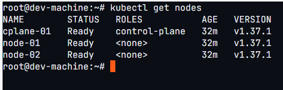
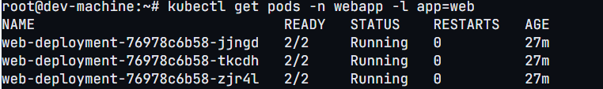
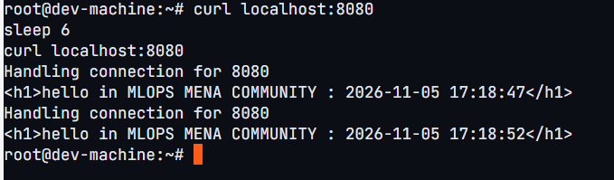
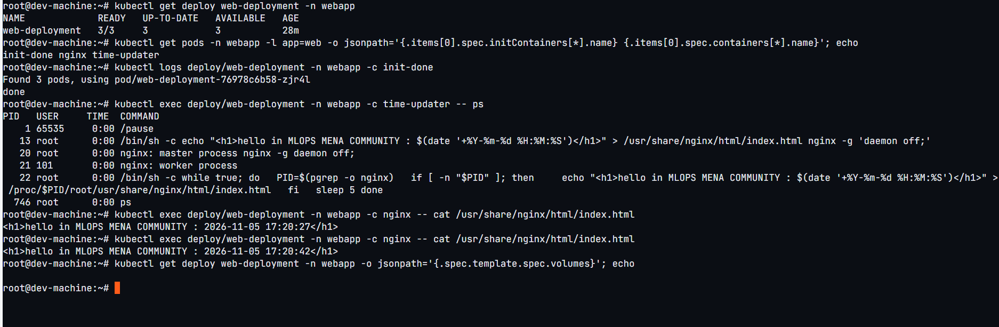
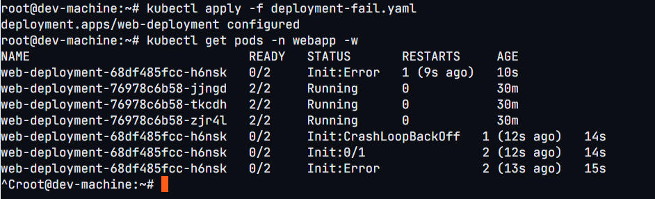
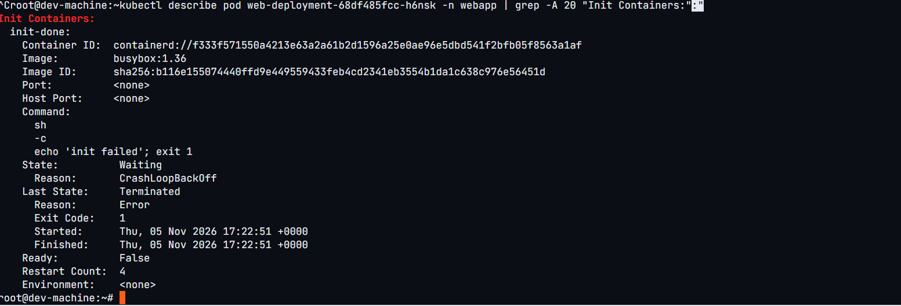
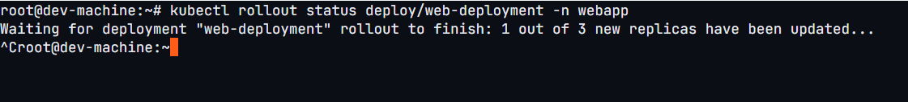
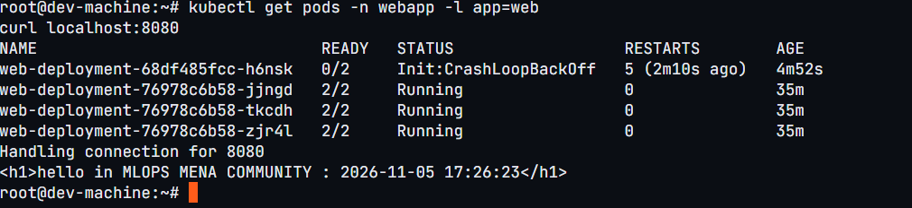
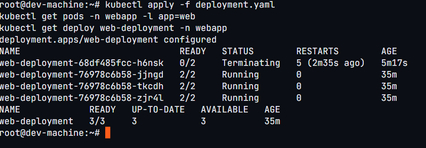

# Task 1: Multi-container Pods (Init Container & Sidecar)

## What I did
I ran the task on the Kube-Labs online playground instead of minikube:
a kubeadm cluster with 1 control-plane node and 2 workers (v1.37.1).
The node names are `cplane-01`, `node-01` and `node-02`.
I ran all `kubectl` commands from the playground's dev machine.
Because the cluster is remote, I tested the page with `kubectl port-forward`
and `curl` instead of opening `localhost:8080` in a browser.

## Files
- `deployment.yaml`: working Deployment (init container, nginx, sidecar)
- `deployment-fail.yaml`: same file with the init container exiting with code 1

## Steps and verification

### 1. Cluster

### 2. Pods running (2/2)

### 3. Page and time updates (curl twice, 5 s apart)

### 4. Verification commands

## Failing init container (Step 5)

**Which status does the new Pod show?**
`Init:Error`, then `Init:CrashLoopBackOff`, with READY `0/2`.

**Do `nginx` and `time-updater` start?**
No. They only start after the init container succeeds.

**Is the page still reachable, and why?**
Yes. The 3 old Pods kept running and serving the page. The Deployment
replaces Pods gradually, and the new Pod never became ready.

## Fix (Step 6)
I applied the original `deployment.yaml` again.
